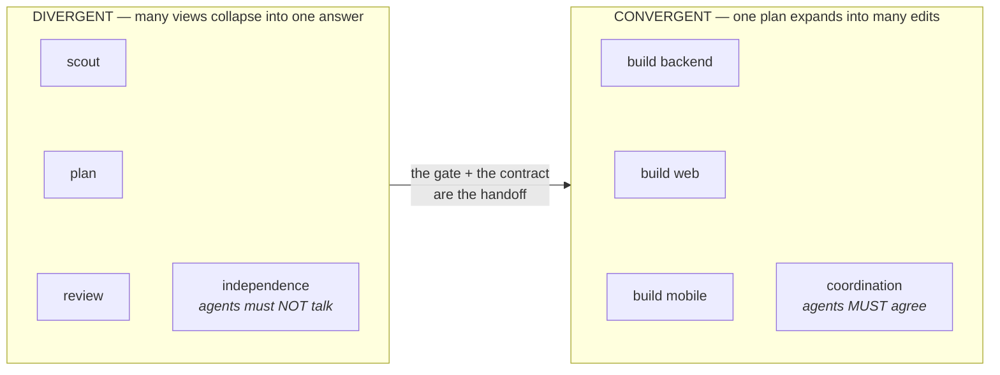
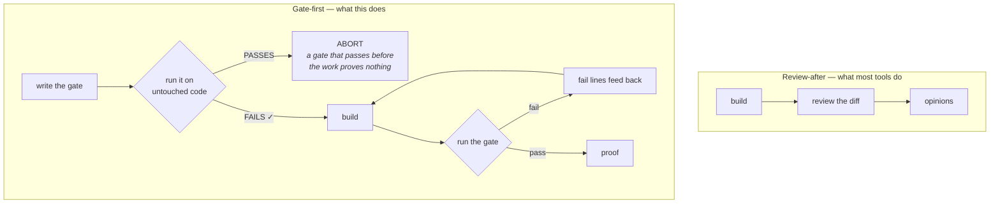
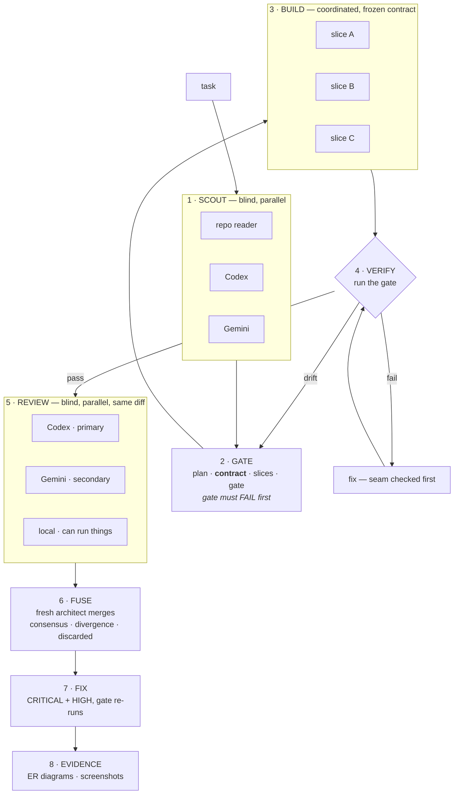
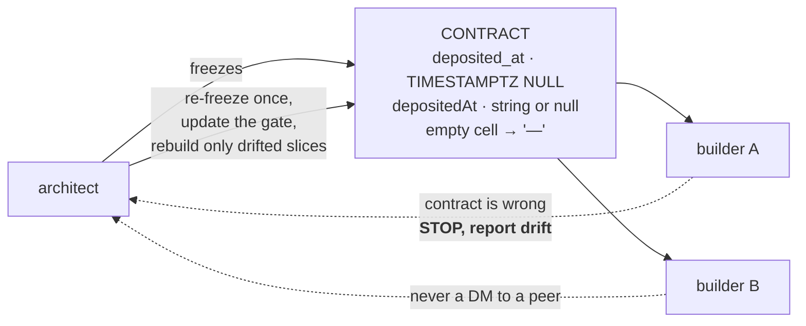

# agent-fusion

**Gate-first multi-model orchestration for Claude Code.**

Write the proof before the code. Build in parallel against a frozen contract.
Have three models review the diff without letting any of them see each other.

```
Workflow({ name: "fuse", args: { task: "add a deposited_at timestamp to collections", repo: "." } })
```

---

## The thesis

Two ideas, and everything here follows from them.

### 1. Divergent work needs independence. Convergent work needs coordination.

Most multi-agent tooling picks one mode and applies it everywhere. That is the
mistake. The two halves of engineering want opposite things.



Scouting, planning and reviewing all collapse many perspectives into one answer.
Independence is the *only* thing that makes them worth anything — two models
handed the same framing are one opinion wearing two hats. Let them talk and you
have destroyed the thing you were paying for.

Building is the opposite. It expands one plan into many edits that must fit
together. An agent that does not know what its neighbour named a field is not
independent, it is **broken**.

So: **blind and parallel on the left, coordinated on the right.**

### 2. A gate written after the code is an opinion. Written before, it is proof.

Every review tool reads a finished diff and offers findings. That tells you what
a model *thinks*. It never tells you the work is done.



The gate is an executable script the architect writes **before any code exists**.
It must fail against the untouched tree. A passing baseline is treated as a
defect in the gate, not as success, and the run aborts. That single inversion is
the difference between "a model said it looks fine" and "this behaviour did not
exist and now it does."

---

## The flow



Duplication happens in exactly two places — Scout and Review — and **never in
Build**. The expensive phase in tokens is the one that writes code, and that
phase has no redundancy at all. The redundancy sits on judgment, which is cheap
by comparison.

---

## The contract, and why there is no agent chat

When several builders work at once, they need to agree on names. The usual answer
is to let them message each other. That is a symptom of an underspecified plan.

Instead, the architect **freezes a contract** before the build starts — every
field name spelled the way each side will spell it, endpoint paths, enum strings,
error shapes, migration column names. Builders implement against it and never
negotiate.



A builder that finds the contract wrong **stops** rather than inventing its own
version. Drift goes back to the architect, who re-freezes once and updates the
gate. That beats peer messaging on three counts: the change is recorded instead
of buried in a DM, the gate learns about it, and there is no message-passing to
reason about.

### The seam

Parallel builders introduce a defect class a single builder cannot produce.
Backend ships `assigned_at`, the client reads `assignedAt`, both slices pass
their own checks, the feature is broken.

**So the gate must exercise the contract end to end, across slices** — not each
slice on its own. The reviewers weight seam defects highest, and the fixer is
told to check the seam *before* looking for anything cleverer. Two slices
disagreeing about casing is more likely than a subtle bug.

---

## Model slots

Roles are **slots, not model names**. Swap one line and nothing else moves.

| Slot | Does | Default |
|---|---|---|
| `ARCHITECT` | plans, writes the gate, fuses the reviews | `fable` xhigh |
| `BUILDER` | implements and fixes | `opus` max |
| `RUNNER` | runs the gate, wraps the advisors | `sonnet` max |
| slice `ui` | interface work — taste, not throughput | `fable` xhigh |
| slice `mechanical` | renames, moves, generated code | `sonnet` max |
| Cross-family | independent review and research | Codex, Gemini |

The cross-family slots are wrappers: a cheap agent shells out and the real
reasoning happens on the other model's bill, not in your context. "Three
reviewers" is not three times the cost of one.

Both cross-family slots are **optional**. Missing advisors are reported as
missing — never faked, never silently replaced by the orchestrator's own opinion.

---

## Install

```bash
git clone https://github.com/heytulsiprasad/agent-fusion.git
cd agent-fusion && ./install.sh          # user scope — every project
./install.sh /path/to/repo               # project scope
./install.sh --link                      # symlink, so edits track this repo
```

Optionally add the plugin for the skill and the push gate:

```bash
claude plugin marketplace add heytulsiprasad/agent-fusion
claude plugin install fusion@agent-fusion
```

Claude Code plugins have no `workflows` component type, which is why the scripts
install separately. The plugin ships the discovery skill and a fail-open push
gate that nudges for a cross-model review before `git push`.

---

## Usage

```js
Workflow({ name: "fuse", args: {
  task: "add a deposited_at timestamp to collections and surface it in the register",
  repo: ".",
  houseRules: "resolve the tenant timezone before comparing against TIMESTAMPTZ"
}})
```

| Arg | Default | Meaning |
|---|---|---|
| `task` | required | what to build |
| `repo` | `.` | repo root, or workspace root for multi-repo work |
| `maxRounds` | `3` | gate-failure rounds before handing back |
| `houseRules` | `''` | extra review lenses for this codebase |
| `skipEvidence` | `false` | skip the PR-evidence phase |

`/pr-evidence` also runs standalone — crow's-foot before/after `erDiagram` blocks
for schema changes, before/after screenshots for UI changes.

---

## What this deliberately does not do

- **It does not commit or push.** It builds, proves and reviews. Landing the work
  is a human decision.
- **It does not survive its own death.** State lives in the run. If it dies at
  Review, a restart starts over. Known gap.
- **It does not manufacture parallelism.** A single-repo, single-concern task
  returns one slice. Splitting work that does not split adds a seam for nothing.
- **It is not for small changes.** 10-18 agents across four model families is
  waste on a one-line fix. There is no floor enforced in code — that judgment is
  yours.

---

## Lineage

The ideas here are not original and the good ones are borrowed on purpose.

- **[ahrar-azmat/agent-teams-plugin](https://github.com/ahrar-azmat/agent-teams-plugin)** —
  the Independence Protocol (dispatch blind, put your hypothesis in a channel
  that refutes it), primary/secondary advisor weighting, and the Runtime
  Capability Law: *"present" is not "supported"*. This repo is a clean
  reimplementation rather than a fork — the original is PolyForm-Noncommercial
  and this is MIT.
- **[disler/fusion-harness](https://github.com/disler/fusion-harness)** and
  IndyDevDan's [model fusion](https://youtu.be/AQl5Q-0l7FQ) — gate-first
  validation, the fuser as a fresh session, roles as slots rather than model
  names.
- **[steveyegge/gastown](https://github.com/gastownhall/gastown)** — separating
  identity from session from sandbox, and the reminder that durable work state
  belongs somewhere the run does not own.

The contribution here is putting the policy in **control flow instead of prose**.
A skill that says "always review before pushing" is advisory; a model can read it
and carry on. A `while` loop cannot be forgotten.

MIT.
